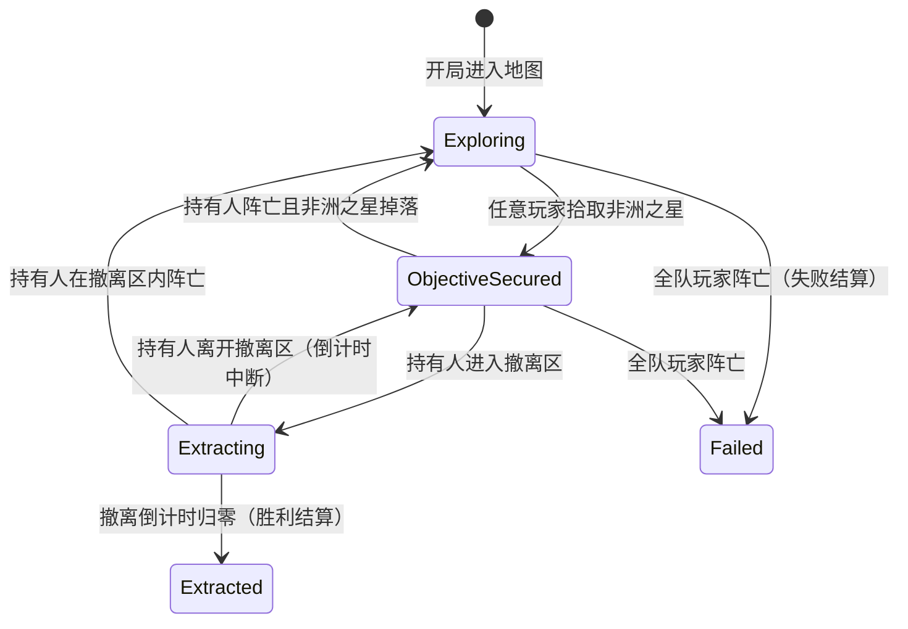

# Spec + TDD 01：类三角洲「搜-打-撤」核心玩法闭环

> **状态**：`[Draft — 待 Mode A 讨论定稿]`
> **所属阶段**：Phase 2 / M2.1 ~ M2.3

---

## 1. 目标与边界（Goal & Non-Goals）

### 目标
1. 建立完整的联机对局阶段机：**探索交火（Exploring）-> 夺取「非洲之星」（ObjectiveSecured）-> 撤离点守点倒计时（Extracting）-> 撤离成功（Extracted）/ 全队阵亡（Failed）**。
2. 落地第一关标志性高价值目标物 **「非洲之星（Heart of Africa）」**：支持靠近交互拾取、全局同步持有人状态、持有人阵亡自动在原地掉落可由队友重新拾取。
3. 落地 **撤离点（Extraction Zone）**：持宝/小队进入指定区域启动倒计时，守点倒计时归零即全队撤离胜利，并弹出简洁结算/重开 UI。

### 明确不做（Non-Goals）
- 不做复杂多格战术背包、局外仓库经济系统、枪械改装台或搜刮几十种杂物箱。
- 第一版专注把**「夺取核心大红（非洲之星）+ 守点撤离」**做到双端联机零 Bug、节奏紧凑。

---

## 2. 对局状态流转

---

## 3. 待拍板设计决策（Mode A 讨论确认）

- [ ] **决策 1 — 撤离触发条件**：是否要求**必须持有「非洲之星」**才能激活撤离点（推荐：更聚焦目标，避免空手乱跑直接撤离）？多人模式下是“持有人在圈内即可全队撤离”还是“所有存活玩家都在圈内”？
- [ ] **决策 2 — 持有人阵亡处理**：持有人阵亡后「非洲之星」原地生成可拾取光柱，队友可继续拾取完成撤离；单人模式下阵亡即直接进入 `Failed` 结算。
- [ ] **决策 3 — 撤离守点增压（可选爽点）**：触发撤离倒计时（例如 10~15 秒）时，是否通知附近/波次敌人向撤离点集结，制造《三角洲》经典的守撤离点紧张感？

---

## 4. 核心类与接口设计（草案）

- **`ETPSMatchPhase`（Enum）**：`Exploring`、`ObjectiveSecured`、`Extracting`、`Extracted`、`Failed`
- **`ATPS_ShootGameState`（继承 `AGameStateBase`）**：
  - `ReplicatedUsing`：`MatchPhase`、`ObjectiveCarrier`（`TObjectPtr<ATPS_ShootCharacter>`）、`ExtractionEndServerTime`（同步服务端截止时间戳而非每帧同步剩余秒数，**省带宽且抗抖动！**）
  - 广播 `OnMatchPhaseChanged`、`OnObjectiveCarrierChanged` 给本地 HUD
- **`ATPS_ShootGameMode`（扩展现有类）**：
  - 权威推进状态转换、监听玩家死亡判定全队是否团灭、提供 `RestartMatch()`（`ServerTravel`）
- **`AExtractionObjectiveActor`（「非洲之星」）**：
  - 球形交互范围 + 发光/图标提示；交互键（`E`）走 `ServerInteract` RPC，服务端校验距离、存活与未被他人抢占（防多人同帧抢拾竞态！）
- **`AExtractionZone`（撤离点）**：
  - 体积触发器 + 绿色烟雾/边界特效，仅服务端处理 Overlap 进出与定时器判定，状态写入 `GameState`

---

## 5. 联机同步与网络优化设计

- **时间戳同步代替每帧倒计时同步**：撤离开始时服务端仅复制一次 `ExtractionEndServerTime`（`float`），各客户端通过 `GetServerWorldTimeSeconds()` 本地平滑计算倒计时进度条，**撤离期间零额外倒计时发包**！
- **并发防竞态**：两个客户端同帧按 `E` 拾取非洲之星时，服务端按 `bIsPickedUp` 原子判断，仅先到达者成功。
- **中途加入 / 断线兜底**：持有人断线（`Logout` / `EndPlay`）时服务端自动将非洲之星掉落在断线位置，防止对局卡死。

---

## 6. 验收标准（Acceptance Criteria）

- [ ] 单人与双人 Listen Server PIE 均能完整走通“拾取非洲之星 -> 撤离倒计时 -> 胜利结算 -> 重开”
- [ ] 双人模式下持有人阵亡或离开撤离区，状态与倒计时正确回退，队友可捡起非洲之星继续撤离
- [ ] 撤离倒计时在弱网下平滑不回跳，结算界面双方同步弹出
