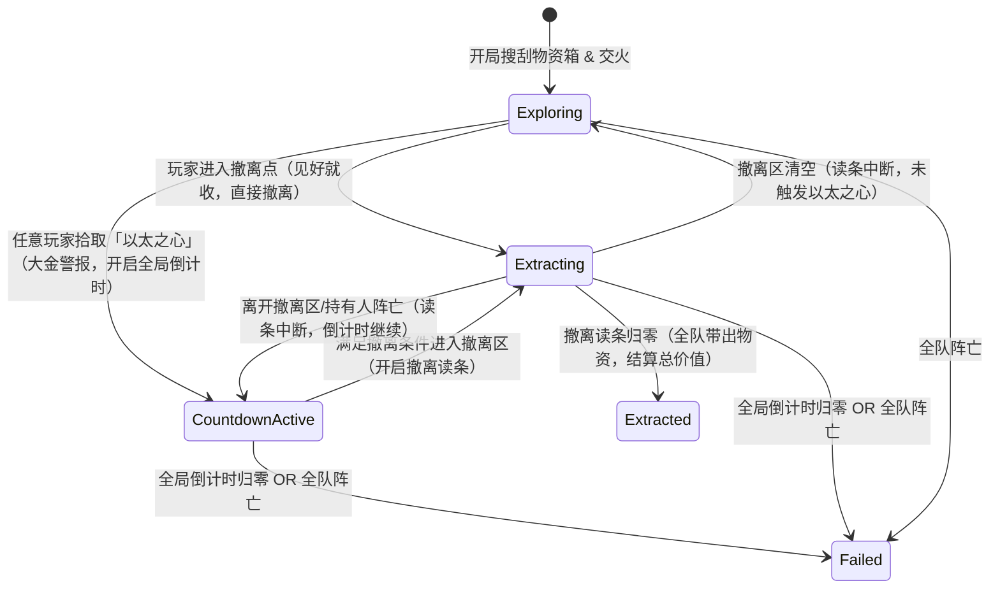

# Spec + TDD 01：轻量级「搜-打-撤」核心玩法闭环（战利品搜刮 + 以太之心 + 撤离结算）

> **状态**：`[Approved — 方案 B（轻量级真·搜打撤）定稿，Mode A 逐步实现]`
> **所属阶段**：Phase 2 / M2.1 ~ M2.4

---

## 1. 目标与边界（Goal & Non-Goals）

### v1 核心目标（真·搜打撤心理博弈，不做重度背包）
1. **「搜」（Search & Risk-Reward）**：
   - 建立统一多态交互接口 **`IInteractableInterface`**（面向接口，支持物资箱、以太之心、阵亡舔包及后续弹药/医疗补给）。
   - 地图散布科技物资箱/数据终端（**`ALootContainerActor`**），按 `E` 读条搜索（如 `1.5s`，移动过远或阵亡打断），开出不同品质与估值的战利品（**`ULootItemDataAsset`**）存入角色轻量 **`ULootInventoryComponent`**（清单 + 携带总价值，无拖拽格子）。
   - 全图唯一顶级大金 **「以太之心（`AAetherCoreActor`）」**：超高估值（如 `$100,000`），拾取后立即触发**全局警报倒计时**，将平静搜刮推向极限撤离高潮。
2. **「打」（Fight & Attrition）**：
   - 外围低危区箱子收益较低，东区核心机房（以太之心所在）由敌方守卫；战斗带来血量与弹药损耗，迫使玩家权衡“见好就收”还是“贪心冲大金”。
3. **「撤」（Extract & High Stakes）**：
   - **撤离点（`AExtractionZone`）** 默认**随时可撤**（`MinRequiredExtractionValue = 0`、`bRequireAetherCoreToExtract = false`，均可在蓝图一键切换策略），进圈读条完成即全队（所有存活玩家）带出当前携带的全部物资并结算总价值。
   - **死亡惩罚与舔包**：玩家阵亡或断线时，个人收益清零；常规战利品原地生成**阵亡掉落包（复用 `ALootContainerActor`）**，若持有「以太之心」则在原地安全贴地掉落，存活队友可舔包/重拾并带出；全队阵亡或倒计时归零则本局 `Failed`（全队收益清零）。
4. **极简实用 HUD**：
   - 交互提示 + 搜箱读条、当前携带总价值与简洁物资清单、阶段/全局倒计时/撤离进度条、胜负结算（展示带出物资总价值）与重开入口。

### 明确不做（Non-Goals — 严格防蔓延）
- **不做**：俄罗斯方块多格拖拽背包、局外仓库存档/拍卖行经济、枪械改装台。
- **v1 暂不做（记入 v2 增强池）**：拿到以太之心后刷额外增援波次、敌人数值狂暴强化。

---

## 2. 对局状态流转

> **灵活配置说明**：`ATPS_ShootGameMode` 提供 `bRequireAetherCoreToExtract`（默认 `false`）与 `MinRequiredExtractionValue`（默认 `0`）。默认规则下，玩家随时可带走已搜物资撤离；一旦拿了「以太之心」，全局倒计时启动，且必须在倒计时结束前把以太之心带入撤离点完成撤离。

---

## 3. C++ 与蓝图职责切分

| 层级 | 负责内容 |
| :--- | :--- |
| **C++（`Source/TPS_Shoot/Extraction/` + `GameMode` + `Character`）** | `ExtractionTypes.h`（枚举/结构体）、`ULootItemDataAsset`、`IInteractableInterface`、`ULootInventoryComponent`（`COND_OwnerOnly` 物资列表与总价值）、`ATPS_ShootGameState`（阶段/持有人/时间戳/带出总价值复制）、`ALootContainerActor`（地图箱 & 阵亡舔包复用）、`AAetherCoreActor`（大金拾取防竞态与贴地掉落）、`AExtractionZone`、`ATPS_ShootGameMode`（权威裁判 + 断线掉落 + `ServerTravel` 重开）、`ATPS_ShootCharacter`（交互射线 + 读条 RPC + 死亡掉落） |
| **Blueprint / Asset** | `DA_Loot_*`（各品质战利品数据资产 + `DA_Loot_AetherCore`）、`BP_LootCrate`（科技补给箱）、`BP_DeathCrate`（阵亡掉落包）、`BP_AetherCore`（以太之心 3D 模型/特效）、`BP_ExtractionZone`（撤离点光柱）、`BP_ThirdPersonGameMode`（配置参数与 `GameStateClass`）、极简搜打撤 HUD |

---

## 4. 核心类与 6 步实现拆解

### Step 1：`ExtractionTypes.h` + `ULootItemDataAsset`
- `Source/TPS_Shoot/Extraction/ExtractionTypes.h`：
  - `EExtractionMatchPhase`：`Exploring`, `CountdownActive`, `Extracting`, `Extracted`, `Failed`
  - `EExtractionFailReason`：`None`, `AllPlayersDead`, `CountdownExpired`
  - `ELootRarity`：`Common`, `Rare`, `Epic`, `Legendary`
  - `FLootItemEntry`：`UPROPERTY() TObjectPtr<ULootItemDataAsset> ItemData` + `int32 Quantity`
- `Source/TPS_Shoot/Extraction/LootItemDataAsset.h/.cpp`（继承 `UDataAsset`）：
  - `FName ItemId`、`FText DisplayName`、`ELootRarity Rarity`、`int32 BaseValue`、`bool bIsAetherCore`、`TObjectPtr<UTexture2D> Icon`

### Step 2：`IInteractableInterface` + `ULootInventoryComponent`
- `Source/TPS_Shoot/Extraction/InteractableInterface.h`：
  - `CanInteract(const ATPS_ShootCharacter* Interactor) const`
  - `GetInteractPrompt(const ATPS_ShootCharacter* Interactor) const`
  - `GetInteractDuration() const`（`0.f` 秒拾，`>0` 读条搜索）
  - `ServerExecuteInteract(ATPS_ShootCharacter* Interactor)`（服务端权威执行）
- `Source/TPS_Shoot/Extraction/LootInventoryComponent.h/.cpp`（挂载在 `ATPS_ShootCharacter`）：
  - `ReplicatedUsing = OnRep_LootItems`（**`COND_OwnerOnly`**）：`TArray<FLootItemEntry> LootItems`
  - `ReplicatedUsing = OnRep_TotalLootValue`：`int32 TotalLootValue = 0`（全员可读，方便队友/结算汇总）
  - `Replicated`：`bool bCarryingAetherCore = false`
  - 服务端接口：`AddLootItem`、`AddLootItems`、`ClearAndExtractAllItems`（阵亡/断线时导出给掉落包并清空）
  - 委托：`OnInventoryUpdated`（供本地 HUD 零 Tick 刷新清单与携带总价值）

### Step 3：`ATPS_ShootGameState`（`Source/TPS_Shoot/Extraction/TPS_ShootGameState.h/.cpp`）
- 继承 `AGameStateBase`（与 `ATPS_ShootGameMode : AGameModeBase` 匹配！）
- 复制属性（零每帧倒计时发包）：
  - `ReplicatedUsing = OnRep_MatchPhase`：`EExtractionMatchPhase MatchPhase`
  - `Replicated`：`EExtractionFailReason FailReason`
  - `ReplicatedUsing = OnRep_ObjectiveCarrier`：`TObjectPtr<ATPS_ShootCharacter> ObjectiveCarrier`
  - `Replicated`：`float CountdownEndServerTime`、`float ExtractionEndServerTime`、`float ExtractionHoldDuration`
  - `Replicated`：`int32 SquadExtractedTotalValue`（撤离成功时结算的全队带出总价值）
- 客户端本地查询接口（`BlueprintPure`，用 `GetServerWorldTimeSeconds()` 计算）：
  - `GetRemainingCountdownSeconds()`、`GetRemainingExtractionSeconds()`、`GetExtractionProgress()`
- 动态多播委托：`OnMatchPhaseChanged`、`OnObjectiveCarrierChanged`

### Step 4：`ALootContainerActor` + `AAetherCoreActor`
- `Source/TPS_Shoot/Extraction/LootContainerActor.h/.cpp`（实现 `IInteractableInterface`）：
  - 既是**地图物资箱**（蓝图配好 `InitialLootPool` 或随机池，搜完后 `bIsLooted = true` 切换打开状态），也可通过 `InitializeAsDeathCrate(const TArray<FLootItemEntry>& Items)` 复用作**玩家阵亡掉落包（舔包）**。
  - `ReplicatedUsing = OnRep_IsLooted`：`bool bIsLooted`
  - 服务端权威 `ServerExecuteInteract`：原子校验未开启 + 距离合法 -> 将箱内物品全部转入 `Interactor->GetLootInventoryComponent()` -> 置 `bIsLooted = true`。
- `Source/TPS_Shoot/Extraction/AetherCoreActor.h/.cpp`（实现 `IInteractableInterface`）：
  - 专属大金展示实体（挂独立网格/光效），`ReplicatedUsing = OnRep_Carrier TObjectPtr<ATPS_ShootCharacter> Carrier`。
  - `TryPickUp(ATPS_ShootCharacter* Picker)`：服务端防双人同帧抢拾 -> 写入 `Picker` 背包（附带 `AetherCoreItemData`）-> 通知 `GameMode` 启动全局倒计时。
  - `DropAtLocation(const FVector& OriginLocation)`：向下射线贴地掉落，防止悬空，恢复可见与可交互。

### Step 5：`AExtractionZone`（`Source/TPS_Shoot/Extraction/ExtractionZone.h/.cpp`）
- 组件：`UBoxComponent* ZoneVolume`
- 仅服务端维护 `TSet<TWeakObjectPtr<ATPS_ShootCharacter>> OverlappingPlayers`，进出时通知 `ATPS_ShootGameMode` 重新评估撤离条件与读条。

### Step 6：串联 `ATPS_ShootGameMode` & `ATPS_ShootCharacter`
- `ATPS_ShootGameMode`：
  - 可配置：`ObjectiveCountdownDuration = 90.f`、`ExtractionHoldDuration = 5.f`、`MinRequiredExtractionValue = 0`、`bRequireAetherCoreToExtract = false`、`bPauseCountdownWhenDropped = false`、`DeathCrateClass`
  - 权威裁决：`HandleAetherCorePickedUp`、`HandleAetherCoreDropped`、`HandleExtractionZoneOccupancyChanged`、`HandlePlayerDied`（生成阵亡掉落包 + 掉落以太之心 + 团灭判定）、`Logout`（断线掉落防死局）、`RestartExtractionMatch`（`ServerTravel`）
- `ATPS_ShootCharacter`：
  - 挂载 `ULootInventoryComponent`
  - 新增 `InteractAction`（`E` 键）：客户端本地探测最近可交互目标（驱动 HUD 交互提示）；按下发 `ServerStartInteract(AActor* Target)`，若时长 `> 0` 则服务端与客户端同步读条，松开/走远/阵亡触发 `ServerCancelInteract()`，读条完成服务端调用 `IInteractableInterface::ServerExecuteInteract`。

---

## 5. 联机同步与防踩坑要点

1. **时间戳代替每秒同步**：全局倒计时与撤离读条都只复制一次截止时间戳，客户端用 `GetServerWorldTimeSeconds()` 实时插值计算剩余秒数。
2. **`COND_OwnerOnly` 精准同步背包**：`ULootInventoryComponent::LootItems` 仅同步给物品所有者，不向全图广播个人明细，为 Phase 3 网络优化提供真实业务基线（后续可进一步演示升级 `FFastArraySerializer`）。
3. **双人同帧抢箱 / 抢大金防竞态**：`ALootContainerActor::bIsLooted` 与 `AAetherCoreActor::Carrier` 均在服务端单线程原子校验，后到者立即拒绝。
4. **死亡/断线防死局**：死亡（`HandleDeath`）与掉线（`Logout`）均安全交接战利品包与以太之心。
5. **`AGameModeBase` 匹配 `AGameStateBase`**：不可错继承 `AGameState`。

---

## 6. 验收标准（Acceptance Criteria）

- [ ] 玩家可按 `E` 读条搜索地图多个科技物资箱，战利品入包且 HUD 实时显示携带总价值
- [ ] 不拿「以太之心」时，玩家可直接进入撤离点完成撤离，结算界面正确显示本局带出总价值
- [ ] 拾取东区大金「以太之心」后立即进入 `CountdownActive` 全局倒计时，且价值显著计入携带总价值
- [ ] 双人 Listen Server PIE 下，持有人或携宝队友阵亡/断线时，常规战利品生成可舔的掉落包、以太之心原地贴地掉落，活着的队友可拾取并带出撤离
- [ ] 倒计时归零或全队阵亡均进入 `Failed`（收益清零）并支持一键重开
- [ ] UBT 编译 0 Error，完成后同步更新 `Docs/01_Architecture.md`、`Docs/02_Roadmap.md`、`Docs/03_Progress_Log.md`
