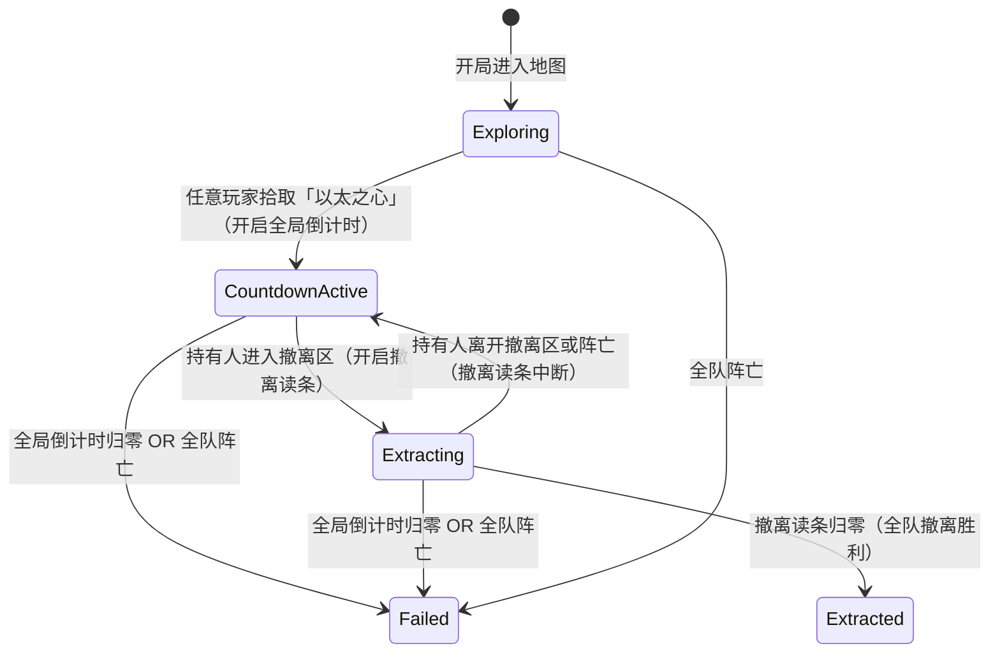

# Spec + TDD 01：类三角洲「搜-打-撤」核心玩法闭环（以太之心 + 撤离点）

> **状态**：`[Approved — v1 规则定稿，待 Mode A 逐步实现]`
> **所属阶段**：Phase 2 / M2.1 ~ M2.3

---

## 1. 目标与边界（Goal & Non-Goals）

### v1 核心目标
1. 建立服务端权威的多人对局阶段机：**探索交火（`Exploring`）-> 夺取「以太之心」开启倒计时（`CountdownActive`）-> 持有人进入撤离点读条（`Extracting`）-> 全队撤离成功（`Extracted`）/ 失败（`Failed`）**。
2. 落地第一关标志性高价值目标物 **「以太之心（`AAetherCoreActor`）」**：
   - 必须有玩家持有「以太之心」才具备撤离资格；
   - 拾取后立即触发全局倒计时（具体秒数通过蓝图配置，不写死）；
   - 持有人阵亡或断线时，以太之心自动在原地安全掉落，队友可继续拾取完成撤离。
3. 落地 **撤离点（`AExtractionZone`）**：持有人进入撤离区触发撤离读条（时长可配置，支持设为 0 即进圈秒撤），读条结束全队（所有存活玩家）一起撤离成功。
4. 极简实用 HUD：当前阶段/目标提示、全局倒计时与撤离进度条、胜负结算与重开入口。

### 明确不做（Non-Goals — 留待 v2 迭代）
- **v1 暂不做**：拿到以太之心/撤离时刷额外增援敌人、敌人数值/狂暴强化（记入 v2 增强池）。
- **不做**：复杂多格搜刮背包、局外仓库经济系统或枪械改装台。

---

## 2. 对局状态流转

> **掉落规则说明**：若持有人在 `CountdownActive` / `Extracting` 期间阵亡或断线，以太之心原地掉落（`ObjectiveCarrier = nullptr`），撤离读条立刻中断；全局倒计时默认继续推进（通过 `bPauseCountdownWhenDropped` 可配置），直到队友重新拾取并进入撤离点。

---

## 3. C++ 与蓝图职责切分

| 层级 | 负责内容 |
| :--- | :--- |
| **C++（`Source/TPS_Shoot/Extraction/` + `GameMode`）** | `EExtractionMatchPhase`、`ATPS_ShootGameState`（阶段/持有人/时间戳复制与本地剩余时间计算）、`AAetherCoreActor`（权威拾取防竞态与贴地掉落）、`AExtractionZone`（区域检测）、`ATPS_ShootGameMode`（权威裁判与 `ServerTravel` 重开）、`ATPS_ShootCharacter::ServerInteract` |
| **Blueprint / Asset** | `BP_AetherCore`（挂实际以太之心模型/光效）、`BP_ExtractionZone`（撤离点光柱/烟雾特效）、`BP_ThirdPersonGameMode`（配置倒计时秒数与 `GameStateClass`）、极简任务/倒计时/结算 UMG |

---

## 4. 核心类与接口设计（v1 架构）

### 4.1 `Source/TPS_Shoot/Extraction/ExtractionTypes.h`
- `UENUM(BlueprintType) enum class EExtractionMatchPhase : uint8 { Exploring, CountdownActive, Extracting, Extracted, Failed };`
- `UENUM(BlueprintType) enum class EExtractionFailReason : uint8 { None, AllPlayersDead, CountdownExpired };`

### 4.2 `ATPS_ShootGameState`（`Source/TPS_Shoot/Extraction/TPS_ShootGameState.h`）
- 继承 `AGameStateBase`（与 `ATPS_ShootGameMode : AGameModeBase` 匹配！）
- 复制属性（零每帧倒计时发包）：
  - `ReplicatedUsing = OnRep_MatchPhase`：`EExtractionMatchPhase MatchPhase`
  - `Replicated`：`EExtractionFailReason FailReason`
  - `ReplicatedUsing = OnRep_ObjectiveCarrier`：`TObjectPtr<ATPS_ShootCharacter> ObjectiveCarrier`
  - `Replicated`：`float CountdownEndServerTime`（拿到以太之心后的倒计时截止服务器时间戳）
  - `Replicated`：`float ExtractionEndServerTime`（进入撤离区后的读条截止服务器时间戳）
  - `Replicated`：`float ExtractionHoldDuration`（供客户端计算 `0~1` 撤离进度条）
- 客户端本地查询接口（`BlueprintPure`）：
  - `GetRemainingCountdownSeconds() const`
  - `GetRemainingExtractionSeconds() const`
  - `GetExtractionProgress() const`
- 动态多播委托（供 HUD 监听，零 Tick 轮询）：
  - `OnMatchPhaseChanged(EExtractionMatchPhase NewPhase, EExtractionFailReason FailReason)`
  - `OnObjectiveCarrierChanged(ATPS_ShootCharacter* NewCarrier)`

### 4.3 `AAetherCoreActor`（`Source/TPS_Shoot/Extraction/AetherCoreActor.h`）
- 组件：`USphereComponent* InteractionSphere`、`UStaticMeshComponent* CoreMesh`
- 属性：`ReplicatedUsing = OnRep_Carrier TObjectPtr<ATPS_ShootCharacter> Carrier`、`float MaxInteractDistance = 260.f`
- 权威接口：
  - `bool TryPickUp(ATPS_ShootCharacter* Picker)`（服务端原子校验：`HasAuthority()` + `!IsValid(Carrier)` + `Picker` 存活 + 距离合法）
  - `void DropAtLocation(const FVector& OriginLocation)`（向下射线找地面防止悬空，恢复显示与交互）
- `OnRep_Carrier`：持有人非空时隐藏地面模型/关闭交互碰撞（或附着到持有人背部 Socket）；为空时恢复显示。

### 4.4 `AExtractionZone`（`Source/TPS_Shoot/Extraction/ExtractionZone.h`）
- 组件：`UBoxComponent* ZoneVolume`
- 仅服务端监听 `OnComponentBeginOverlap` / `OnComponentEndOverlap`，维护 `TSet<TWeakObjectPtr<ATPS_ShootCharacter>> OverlappingPlayers`，提供 `IsCharacterInside(const ATPS_ShootCharacter* Character) const` 并通知 `ATPS_ShootGameMode` 重新评估撤离状态。

### 4.5 扩展 `ATPS_ShootGameMode` & `ATPS_ShootCharacter`
- `ATPS_ShootGameMode`：
  - 可配置参数：`ObjectiveCountdownDuration`（默认如 `90.f`）、`ExtractionHoldDuration`（默认如 `5.f`）、`bPauseCountdownWhenDropped`（默认 `false`）
  - 权威入口：`HandleObjectivePickedUp`、`HandleObjectiveDropped`、`HandleExtractionZoneOccupancyChanged`、`HandlePlayerDied`、`Logout`（断线兜底掉落）、`RestartExtractionMatch`
- `ATPS_ShootCharacter`：
  - 新增 `InteractAction`（`E` 键）-> `ServerInteract()` RPC -> 服务端查找距离内最近的可拾取 `AAetherCoreActor` 并尝试 `TryPickUp`。

---

## 5. 联机同步与防踩坑要点

1. **时间戳代替每秒同步**：全局倒计时与撤离读条都只复制一次截止时间戳，客户端用 `GetServerWorldTimeSeconds()` 实时插值计算剩余秒数，弱网零跳动、零额外带宽。
2. **双人同帧抢拾竞态**：`TryPickUp` 仅在服务端同步执行，`Carrier` 非空立即拒绝后到者。
3. **持有人死亡/断线防死局**：玩家死亡（`UHealthComponent::OnDeath`）与掉线（`AGameModeBase::Logout`）均触发 `DropAtLocation`，杜绝以太之心随死亡/断线消失。
4. **`AGameModeBase` 匹配 `AGameStateBase`**：注意项目基类是 `AGameModeBase`，不要错继承 `AGameState`（否则 UE 启动会报 GameState 类不匹配警告）。

---

## 6. 验收标准（Acceptance Criteria）

- [ ] 单人与 2 Players Listen Server PIE 均能完整走通：拾取以太之心 -> 开启倒计时 -> 进撤离点读条 -> 全队胜利结算 -> 重开
- [ ] 未持有以太之心进入撤离点**不会**触发撤离
- [ ] 双人模式下持有人阵亡或断线，以太之心原地贴地掉落，队友拾取后可继续完成撤离
- [ ] 倒计时归零或全队阵亡均正确进入 `Failed` 结算并同步到所有客户端
- [ ] UBT 编译 0 Error，完成后同步更新 `Docs/01_Architecture.md`、`Docs/02_Roadmap.md`、`Docs/03_Progress_Log.md`
