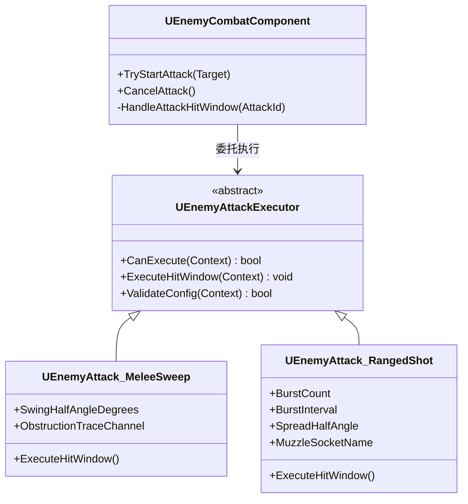

# Spec + TDD 03：高扩展性敌人战斗框架与远程敌人（第二核心亮点）

> **状态**：`[Draft — 待 Mode A 评审抽象方案]`
> **所属阶段**：Phase 4 / M4.1 & M4.2

---

## 1. 目标与边界（Goal & Non-Goals）

### 目标
1. **将现有近战敌人战斗框架升级为“通用可扩展战斗框架”**：保留 `UEnemyCombatComponent` 已验证的服务端 `AttackId` 状态机、`UBTTask_EnemyAttack` 实例内存和 `AAEnemyAIController` 多人仇恨防抖，把“具体如何执行攻击判定”解耦成可扩展策略。
2. **新增 1 种远程射击敌人（Ranged Trooper）**：完全复用 `AEnemyBase`、`AAEnemyAIController`、`UHealthComponent`、`UBTTask_EnemyAttack`，仅通过新增远程攻击策略与 DataAsset 配置即可落地。
3. **接入 EQS（Environment Query System）**：让远程敌人具备基础战术行为（保持理想射程、寻找有视野的掩体/侧翼位置、玩家过近时后撤拉开距离）。

### 明确不做（Non-Goals）
- 不做复杂小队通讯战术树或大规模百人同屏群集优化（保持 5~10 只敌人在一关内高表现力、低延迟稳定运行）。

---

## 2. 架构重构方案（开闭原则 OCP 实践）

### 现状耦合点
`UEnemyCombatComponent::HandleAttackHitWindow` 当前写死了近战三道几何校验（距离 + 扇形 + 遮挡线检测 -> `ApplyPointDamage`），如果直接加 `if (bIsRanged)` 会迅速膨胀成面条代码。

### 扩展架构（推荐：`Instanced UObject` 策略模式）
在 `FEnemyAttackSpec` 中引入可扩展的 `UPROPERTY(EditDefaultsOnly, Instanced) TObjectPtr<UEnemyAttackExecutor> AttackExecutor`（或在 DataAsset 中配置攻击行为子类）：

- **架构价值**：未来再扩充“手雷投掷怪”“冲锋自爆怪”或“Boss 扇形激光”，只需新增一个 `UEnemyAttackExecutor` 子类并配进 DataAsset，**`AEnemyBase`、`UEnemyCombatComponent`、`UBTTask_EnemyAttack` 零修改**！

---

## 3. 远程敌人与 EQS 战术行为设计

- **感知与仇恨**：直接复用 `AAEnemyAIController`（视觉感知 + 受击索敌 + 多人仇恨防抖）。
- **EQS 查询（`EQS_FindRangedAttackPos`）**：
  - 生成器：围绕目标的环形/网格候选点（距离在 `[MinPreferredRange, MaxAttackRange]` 之间）。
  - 测试项：
    1. `Trace`（必须对目标有清晰射击视线，剔除被墙挡死的点）；
    2. `Distance`（偏好中距离交火区，避免贴脸）；
    3. `PathExist`（必须可达且在 NavMesh 上）。
- **远程攻击表现与联机**：
  - 服务端按配置执行点射（含轻微随机散布，避免 100% 锁头秒杀玩家），通过 `Unreliable` Multicast 同步枪口焰/弹道拖尾/音效（遵循 Phase 3 网络优化红线，不生成高开销复制子弹 Actor）。

---

## 4. 验收标准（Acceptance Criteria）

- [ ] 重构后原有近战敌人 `BP_Whisper` 行为、伤害、动画与 `DA_WhisperCombatConfig` 100% 回归正常
- [ ] 新增远程敌人无需新建专用 C++ Character 子类，即可在关卡中与 `BP_Whisper` 协同守卫「非洲之星」
- [ ] EQS 调试视图验证远程敌人能主动寻找有视野的理想射击位，近战受阻或被近身时有合理位移
- [ ] 双端 Listen Server PIE 下远程敌人射击表现与伤害同步一致
