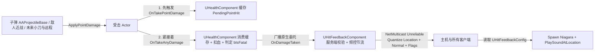

# Spec + TDD 05：受击反馈系统（Hit Feedback System）

> **状态**：`[Approved — 待实现]`
> **所属阶段**：Phase 5 / 战斗反馈前置落地（覆盖玩家 `ATPS_ShootCharacter` 与敌人 `AEnemyBase`）
> **架构决策**：采用「`UHealthComponent` 统一收口伤害上下文 + 独立 `UHitFeedbackComponent` + `UHitFeedbackConfig` DataAsset」分层解耦方案。

---

## 1. 目标与边界（Goal & Non-Goals）

### 目标
1. 为**敌人（`AEnemyBase`）**与**玩家（`ATPS_ShootCharacter`）**建立统一、可扩展、多人同步友好的受击视听反馈系统（Niagara 粒子 + 受击音效）。
2. 将「数值扣血（`UHealthComponent`）」与「表现渲染（`UHitFeedbackComponent`）」彻底解耦，遵循单一职责原则（SRP）。
3. 由 `UHealthComponent` 统一承接 `OnTakePointDamage` 与 `OnTakeAnyDamage`，避免重复扣血，同时为后续的**爆头部位伤害倍率**、**致死一击强化特效**与**攻击者 Hitmarker 确认**预留单一扩展管道。
4. 通过 `UHitFeedbackConfig`（`UDataAsset`）实现数据驱动配置，支持不同角色/敌人类别共享或独立替换受击资产（含旋转偏移、缩放与音效并发控制）。

### 明确不做（Non-Goals）
- 本期**暂不处理墙面/静态场景材质撞击特效**（现有 `AWeaponBase::HandleProjectileImpact` 弹孔逻辑保持不变，后续可按 `EPhysicalSurface` 扩展）。
- 本期**暂不实现受击动画硬直（HitReact Montage）与材质闪白（HitFlash）**，但保留在 `UHitFeedbackComponent::PlayLocalHitFeedback` 中的单一扩展入口。

---

## 2. 伤害与受击表现数据流

### 关键防坑设计（UE `AActor::TakeDamage` 执行顺序）
- 在 `AActor::TakeDamage` 中，当收到 `ApplyPointDamage` 时，引擎会**先同步触发 `OnTakePointDamage`，再同步触发 `OnTakeAnyDamage`**。
- **严禁在两个回调中各自扣血**（会导致双倍伤害）。
- 正确模式：`HandleTakePointDamage` 仅将命中点、法线、骨骼名写入 `PendingPointHit`；紧随其后的 `HandleTakeAnyDamage` 立即取出并**清空** `PendingPointHit`，完成一次扣血并对外广播统一的 `FDamageTakenEvent`。即使未来有调用普通 `ApplyDamage`（无命中点）的伤害源，也能安全回退到 Actor 中心点。

---

## 3. C++ 与蓝图职责切分

| 层级 | 负责内容 |
| :--- | :--- |
| **C++** | `FDamageTakenEvent` 与 `UHealthComponent` 统一伤害收口、`UHitFeedbackConfig`（DataAsset + 编辑器校验）、`UHitFeedbackComponent`（服务端节流 + `Unreliable` Multicast + 本地 Niagara/音效播放）、在 `AEnemyBase` 与 `ATPS_ShootCharacter` 构造函数中创建组件 |
| **Blueprint / Asset** | 创建 `DA_PlayerHitFeedback` / `DA_WhisperHitFeedback` 等 DataAsset、指定刚导入的 `UNiagaraSystem` 与音效/并发规则、微调 `RotationOffset` 与 `EffectScale`、核对敌人 Mesh/Capsule 对子弹碰撞通道设置 |

---

## 4. 核心数据结构与类接口设计

### 4.1 扩展 `UHealthComponent`（`Source/TPS_Shoot/Health/HealthComponent.h`）
- 新增结构体 `FDamageTakenEvent`（C++ 原生轻量结构，仅服务端内部流转）：
  - `float Damage`
  - `FVector HitLocation` / `FVector HitNormal`
  - `FName HitBoneName`
  - `bool bHasHitInfo` / `bool bIsHeadshot` / `bool bIsFatal`
  - `TWeakObjectPtr<AController> InstigatedBy` / `TWeakObjectPtr<AActor> DamageCauser`
- 新增原生多播委托：`FOnDamageTaken OnDamageTaken;`（仅服务端在有效扣血后广播）
- 私有缓存：`FPendingPointHit PendingPointHit;`（`HandleTakePointDamage` 写入，`HandleTakeAnyDamage` 消费并重置）

### 4.2 新增 `UHitFeedbackConfig`（`Source/TPS_Shoot/Combat/HitFeedbackConfig.h`）
继承 `UDataAsset`：
- `TObjectPtr<UNiagaraSystem> DefaultHitVFX`
- `TObjectPtr<UNiagaraSystem> HeadshotHitVFX`（留空则回退 `DefaultHitVFX`）
- `TObjectPtr<UNiagaraSystem> FatalHitVFX`（可选，留空则回退普通/爆头特效）
- `FRotator EffectRotationOffset = FRotator::ZeroRotator`（修正商店特效包轴向差异）
- `FVector EffectScale = FVector::OneVector`
- `TObjectPtr<USoundBase> HitSound`
- `TObjectPtr<USoundAttenuation> HitSoundAttenuation`
- `TObjectPtr<USoundConcurrency> HitSoundConcurrency`
- `float MinFeedbackInterval = 0.05f`（高频集火/霰弹防刷屏节流间隔）
- `#if WITH_EDITOR`: 重写 `IsDataValid` 检查是否至少配置了 VFX 或 Sound

### 4.3 新增 `UHitFeedbackComponent`（`Source/TPS_Shoot/Combat/HitFeedbackComponent.h`）
继承 `UActorComponent`（`SetIsReplicatedByDefault(true)`，`bCanEverTick = false`）：
- `UPROPERTY(EditDefaultsOnly, BlueprintReadOnly, Category = "HitFeedback") TObjectPtr<UHitFeedbackConfig> FeedbackConfig;`
- 服务端 `BeginPlay`：查找宿主 `UHealthComponent`，订阅 `OnDamageTaken`。
- 服务端收到 `HandleDamageTaken(const FDamageTakenEvent& Event)`：
  1. 检查 `FeedbackConfig` 有效且距离上次触发 `>= MinFeedbackInterval`（致死一击 `bIsFatal` 可放行不受节流限制！）；
  2. 打包 1 字节位标志 `uint8 HitFlags`（bit 0 = `bIsHeadshot`，bit 1 = `bIsFatal`）；
  3. 调用 `MulticastPlayHitFeedback(HitLocation, HitNormal, HitFlags)`。
- `UFUNCTION(NetMulticast, Unreliable) void MulticastPlayHitFeedback(FVector_NetQuantize HitLocation, FVector_NetQuantizeNormal HitNormal, uint8 HitFlags);`
  - 独立服务器直接 `return`；
  - 根据 `HitFlags` 从 `FeedbackConfig` 选择对应 `UNiagaraSystem`；
  - 计算旋转：`const FRotator SpawnRotation = (HitNormal.IsNearlyZero() ? FRotator::ZeroRotator : HitNormal.Rotation()) + Config->EffectRotationOffset;`（或用四元数组合 `FQuat` 避免万向节偏转）；
  - `UNiagaraFunctionLibrary::SpawnSystemAtLocation(..., bAutoDestroy = true)`；
  - 播放 `HitSound`（带 `Attenuation` / `Concurrency`）。

---

## 5. 联机同步与网络优化方案

- **权威端**：仅服务端在 `UHealthComponent` 确认有效扣血后触发，彻底杜绝打尸体或无效命中浪费 RPC。
- **带宽压缩**：使用 `NetMulticast, Unreliable` + `FVector_NetQuantize` + `FVector_NetQuantizeNormal` + `uint8 HitFlags`（单次表现包体极小，且不堵塞 Reliable Buffer）。
- **高频集火节流**：通过 `MinFeedbackInterval`（默认 `0.05s`）限制全自动扫射/多人集火时的 RPC 与粒子生成速率，**致命击杀（`bIsFatal`）豁免节流**保证击杀反馈永不丢失。
- **零资产指针传输**：RPC 不传 `UNiagaraSystem*` 对象引用，只传 1 字节 `HitFlags`，各端从本地 `FeedbackConfig` DataAsset 查表。

---

## 6. 验收标准（Acceptance Criteria）

- [ ] 冲锋枪/手枪射击敌人时，不会造成双倍伤害（验证 `OnTakePointDamage` + `OnTakeAnyDamage` 无重复扣血）
- [ ] 敌人被子弹击中、玩家被 `Whisper` 近战击中时，在精确命中点沿法线方向生成各自配置的受击特效与音效
- [ ] 敌人死亡后的尸体再次被射击不会触发受击特效
- [ ] Listen Server + Client（2 Players PIE）下双方都能正确看到彼此与敌人的受击特效，弱网下无异常卡顿或 Reliable 队列溢出
- [ ] UBT 编译 0 Error，完成后同步更新 `Docs/01_Architecture.md`、`Docs/02_Roadmap.md`、`Docs/03_Progress_Log.md`
