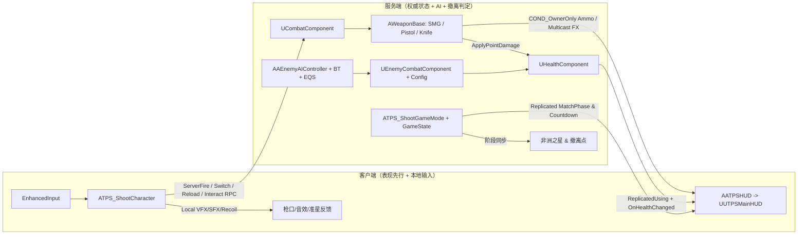

# TPS_Shoot — 多人联机搜打撤第三人称射击演示项目（UE 5.8）

> 基于 **Unreal Engine 5.8** 与 **纯 C++ 组件化架构** 开发的第三人称联机搜打撤（Extraction TPS）演示项目。
> 仓库地址：[https://github.com/lmllajsal090/TPS_Shoot](https://github.com/lmllajsal090/TPS_Shoot)

本项目以类《三角洲行动》的**「搜-打-撤」**为核心玩法闭环（夺取高价值目标物 **「非洲之星」** 并成功抵达撤离点守点撤离），定位为个人**最主打的客户端 / 战斗 / 联机工程作品**，重点展示 **Listen Server 联机同步与网络优化、可扩展组件化敌人 AI 框架、以及 3C 射击手感**。

---

## 核心技术亮点

| 维度 | 架构落点与工程亮点 |
| :--- | :--- |
| **联机同步与网络优化（第一核心）** | Listen Server 服务端权威架构；`FVector_NetQuantize` 压缩、精准复制条件（`COND_OwnerOnly` / `COND_SkipOwner`）、客户端开火表现先行（消除 RTT 手感延迟）、高频弹道同步优化与 UE Network Emulation（弱网模拟）实测量化 |
| **搜打撤玩法闭环（类三角洲）** | `GameMode` + `GameState` 同步对局阶段机（探索 -> 夺取「非洲之星」-> 撤离点倒计时守点 -> 撤离成功/全灭失败），支持目标物持有人标记与阵亡掉落再争夺 |
| **高扩展性敌人 AI 框架（第二核心）** | `AEnemyBase` + `AAEnemyAIController`（视觉感知 + 受击索敌 + **多人仇恨防抖**）+ `UEnemyCombatComponent`（服务端 `AttackId` 防串台状态机）+ `UEnemyCombatConfig`（DataAsset 配招表与编辑器校验），通过策略抽象无缝扩展近战与远程/EQS 敌人 |
| **武器体系与 3C 手感** | 三槽位武器系统（冲锋枪 / 手枪 / 规划中的近战小刀，含切刀移速加成）；ADS 开镜插值（FOV/臂长/移速/灵敏度）、后坐力、动态扩张准星、左手 IK 预留与弹孔贴花同步 |
| **事件驱动 UI 分层** | `AATPSHUD` 监听 `OnPossessedPawnChanged`，经由组件委托驱动血条平滑插值、弹药、准星与撤离进度，零 Tick 轮询 |

---

## 核心系统架构图



---

## 文档导航（Documentation Index）

- **AI 协作宪法**：[AGENTS.md](AGENTS.md)（默认 Mode A 协作协议、联机与蓝图红线、**新增功能必同步文档铁律**）
- **当前架构快照**：[Docs/01_Architecture.md](Docs/01_Architecture.md)（现有全部 C++ 类、复制拓扑、敌人状态机与蓝图资产映射）
- **开发路线图**：[Docs/02_Roadmap.md](Docs/02_Roadmap.md)（搜打撤闭环 -> 联机优化专项 -> 可扩展敌人与远程怪 -> 小刀与 3C 收口）
- **进度与决策日志（ADR）**：[Docs/03_Progress_Log.md](Docs/03_Progress_Log.md)
- **功能设计书（Spec + TDD）**：
  - [模板：Spec + TDD](Docs/Specs/_TEMPLATE.md)
  - [01 - 类三角洲搜打撤闭环（非洲之星 + 撤离点）](Docs/Specs/01_Extraction_Loop.md)
  - [02 - 联机体验与网络带宽优化专项](Docs/Specs/02_Multiplayer_And_Network_Optimization.md)
  - [03 - 高扩展敌人战斗框架与远程 AI](Docs/Specs/03_Extensible_Enemy_And_Ranged_AI.md)
  - [04 - 近战小刀（3号槽）、战斗反馈与 3C 动作](Docs/Specs/04_Knife_Weapon_And_3C_Polish.md)

---

## 快速开始（Quick Start）

### 环境要求
- Unreal Engine **5.8**
- Visual Studio 2022（C++ 游戏开发工作负载）或 JetBrains Rider

### 编译命令（PowerShell）
```powershell
& "C:\Program Files\Epic Games\UE_5.8\Engine\Build\BatchFiles\Build.bat" TPS_ShootEditor Win64 Development -Project="C:\UEProjects\TPS_Shoot_Original_5_8\TPS_Shoot.uproject" -WaitMutex -FromMsBuild
```

---

## 演示与弱网性能对比（Showcase）

> 待搜打撤闭环与联机优化专项完成后，补充双端联机实机 GIF 与 `stat net` / Network Insights 优化前后量化对比表。
